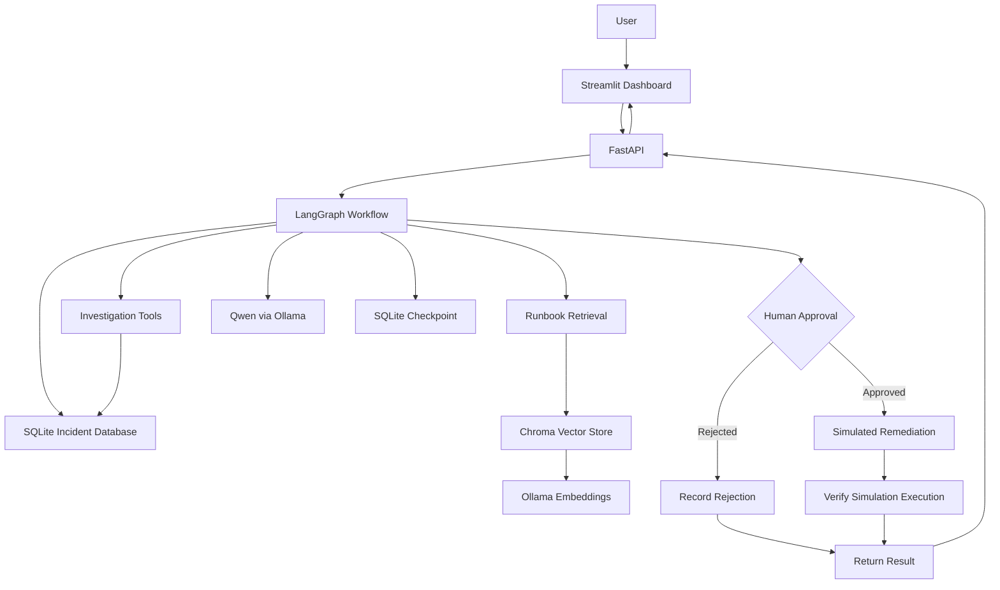
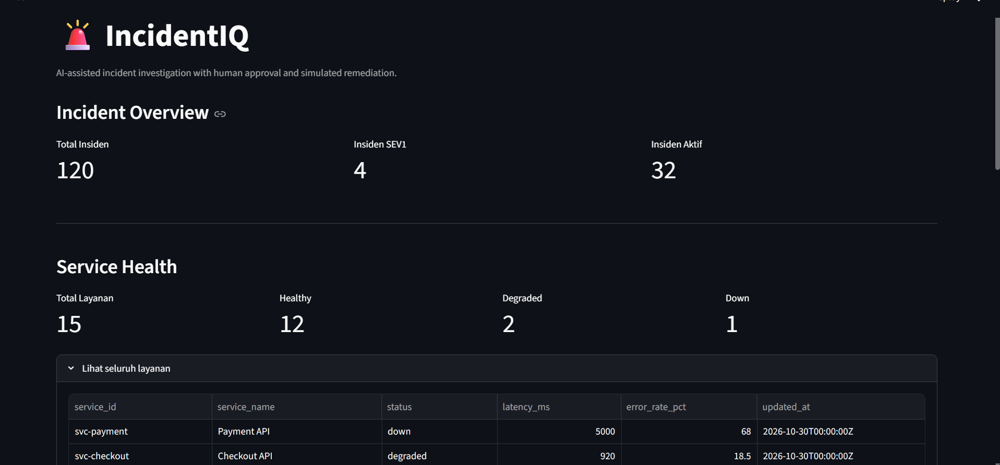
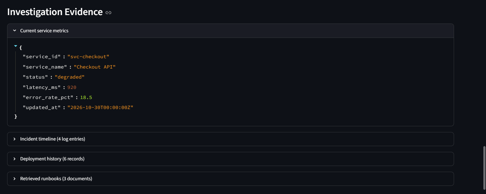

# IncidentIQ — AI Incident Response Agent

IncidentIQ is an AI-assisted incident investigation system that combines
structured operational data, runbook retrieval, large language models,
and human approval in a single workflow.

The system investigates simulated software incidents, gathers evidence
from SQLite, retrieves operational guidance using RAG, generates an
evidence-based analysis, and proposes a remediation action.

**Safety by design:** remediation is simulation-only. The application
does not modify real services or verify recovery of real infrastructure.

## Key Features

- **Incident investigation:** retrieve incident details, service metrics,
  chronological logs, and deployment history.
- **RAG with runbooks:** retrieve relevant operational guidance using
  Chroma and Ollama embeddings.
- **LLM-based analysis:** use a locally hosted Qwen model to summarize
  observed facts, hypotheses, and uncertainties.
- **Tool-assisted workflow:** use deterministic Python tools to access
  incident data and operational knowledge.
- **Human-in-the-loop approval:** pause the LangGraph workflow until
  a human approves or rejects the proposed simulation.
- **Persistent workflow checkpoints:** use SQLite checkpoints to resume
  an investigation using the same thread ID.
- **API and dashboard:** expose workflow capabilities through FastAPI
  and provide a Streamlit interface.
- **Automated tests:** test database behavior, tools, workflow logic,
  API behavior, and safety-related response contracts.

## Architecture



## Screenshots

### Dashboard Overview

The dashboard provides an overview of incident severity and the
health of all registered services.



### AI Investigation Evidence

The investigation report exposes the service metrics, incident timeline,
deployment history, and runbooks retrieved by the RAG pipeline.



### Human Approval and Simulation

The workflow pauses for an explicit human decision before proceeding.
Approved actions are simulated only; the application does not modify
real services or confirm recovery of production infrastructure.

## Technology Stack

| Component           | Technology                          |
| ------------------- | ----------------------------------- |
| Language            | Python                              |
| LLM                 | Qwen via Ollama                     |
| Agent workflow      | LangGraph                           |
| LLM integration     | LangChain Core and LangChain Ollama |
| Relational database | SQLite                              |
| Vector database     | Chroma                              |
| Embedding model     | `nomic-embed-text` via Ollama       |
| Backend API         | FastAPI                             |
| Request validation  | Pydantic                            |
| Frontend            | Streamlit                           |
| Automated testing   | Pytest and HTTPX                    |

## Project Structure

```text
incidentiq-ai-agent/
├── incidentiq/
│   ├── __init__.py
│   ├── config.py
│   ├── database.py
│   ├── schemas.py
│   ├── tools.py
│   ├── agent_tools.py
│   ├── knowledge_base.py
│   ├── workflow.py
│   ├── api.py
│   └── seed_data.py
├── data/
│   └── runbooks/
│       ├── 01-checkout-http-500.md
│       ├── 02-database-latency.md
│       └── 03-payment-timeouts.md
├── tests/
│   ├── test_database.py
│   ├── test_tools.py
│   ├── test_knowledge_base.py
│   ├── test_workflow.py
│   └── test_api.py
├── app.py
├── requirements.txt
├── .env.example
├── .gitignore
└── README.md
```

Generated SQLite databases, workflow checkpoints, and Chroma files are
created locally and are not committed to the repository.

## Requirements

- Python 3.11 or another Python version supported by the installed
  dependencies.
- Ollama installed and running locally.
- Sufficient system resources to run the selected local language model.
- Git for cloning the repository.

## Installation

### 1. Clone the repository

```bash
git clone <YOUR_GITHUB_REPOSITORY_URL>
cd incidentiq-ai-agent
```

Replace `<YOUR_GITHUB_REPOSITORY_URL>` with the repository URL.

### 2. Create a virtual environment

Windows PowerShell:

```powershell
python -m venv .venv
.\.venv\Scripts\Activate.ps1
```

Install the project dependencies:

```powershell
python -m pip install --upgrade pip
pip install -r requirements.txt
```

### 3. Prepare Ollama models

Make sure Ollama is running, then download the models:

```bash
ollama pull qwen3:4b-instruct
ollama pull nomic-embed-text
```

Check that both models are available:

```bash
ollama list
```

The application uses the first model for incident analysis and the
second for runbook embeddings.

### 4. Configure environment variables

Copy the example configuration:

```powershell
Copy-Item .env.example .env
```

The default configuration uses a local SQLite database and the local
FastAPI address. Adjust the values in `.env` when needed.

### 5. Initialize the synthetic incident data

From the project root, run:

```bash
python -m incidentiq.seed_data
```

This command should create or seed the local incident database using
the project's seed-data implementation.

If an existing local database contains stale seeded records, back it up
or remove it before recreating the dataset. Do not remove a database
that contains data you need to keep.

### 6. Build the runbook knowledge base

```bash
python -m incidentiq.knowledge_base
```

The command indexes the Markdown runbooks into the local Chroma vector
store. The initial indexing requires the embedding model to be available.

## Running the Application

Start the backend from the project root:

```bash
uvicorn incidentiq.api:app --reload
```

Open the interactive API documentation:

- Swagger UI: http://127.0.0.1:8000/docs
- Health check: http://127.0.0.1:8000/health

In another terminal, activate the same virtual environment and run:

```bash
streamlit run app.py
```

Open the Streamlit URL shown in the terminal, usually
http://localhost:8501.

Keep the backend, frontend, and Ollama available while using the local
application.

## API Endpoints

| Method | Endpoint                          | Purpose                                            |
| ------ | --------------------------------- | -------------------------------------------------- |
| GET    | `/health`                         | Check API availability                             |
| GET    | `/incidents`                      | List incidents with affected service information   |
| GET    | `/services`                       | Retrieve all services and health summary           |
| POST   | `/incidents/investigate`          | Investigate an incident and request human approval |
| POST   | `/incidents/{thread_id}/approval` | Resume the workflow with an approval decision      |

### Example: Start an investigation

Request:

```json
{
  "incident_id": "INC-1001"
}
```

A successful investigation returns a thread ID, AI analysis, proposed
action, and collected evidence. When the workflow is waiting for
approval, the response status is `awaiting_approval`.

### Example: Approve a simulation

Use the `thread_id` returned by the investigation:

```json
{
  "approved": true,
  "reason": "Approved for simulation testing"
}
```

The workflow resumes from its approval checkpoint. The result can
contain the status `simulated`, but this does not mean a real service
has recovered.

### Example: Reject a simulation

```json
{
  "approved": false,
  "reason": "Further investigation required"
}
```

The workflow records the rejection and does not run the simulation
node.

## Investigation Workflow

1. **Load incident:** retrieve the incident and affected service.
2. **Collect evidence:** read the incident timeline, deployment history,
   current service metrics, and relevant runbooks.
3. **Analyze:** ask the LLM to distinguish observed facts, hypotheses,
   and remaining uncertainties.
4. **Propose action:** select a predefined simulation based on the
   affected service.
5. **Request human approval:** interrupt the LangGraph workflow and
   persist the checkpoint.
6. **Resume workflow:** continue with the same thread ID after approval
   or rejection.
7. **Simulate and verify:** if approved, record that the simulation node
   executed. Verification is limited to the simulated workflow result.

## Running Tests

From the project root:

```bash
python -m pytest -q
```

The test suite covers database initialization and integrity, seeded data,
SQL tools, runbook loading and validation, workflow behavior, and API
responses.

The current development baseline is **30 passing tests**. This count
refers to the latest local test run and may change as more tests are added.

## Safety and Limitations

- All incident data is synthetic.
- The system does not connect to real production monitoring systems.
- Remediation actions are simulations only; no real service is modified.
- A successful simulation is not proof of real-world recovery.
- LLM output may contain incorrect or incomplete interpretations.
  Investigators should compare the analysis with the collected evidence.
- Runbook retrieval depends on the contents of the local knowledge base
  and the quality of the embedding and query match.
- The local application requires the configured Ollama models to be
  available.

## Future Improvements

- Add automated integration tests for the full approval-resume cycle.
- Improve runbook relevance evaluation and source attribution.
- Add richer visualizations for incident timelines and service metrics.
- Add structured analysis fields for facts, hypotheses, and uncertainties.
- Add authentication and authorization before exposing the API beyond
  a trusted local environment.
- Add controlled adapters for real observability platforms only after
  introducing appropriate authorization, audit logging, and safeguards.

## License

Add a license file before distributing this project publicly. Do not
claim a license unless one has actually been selected and included.
